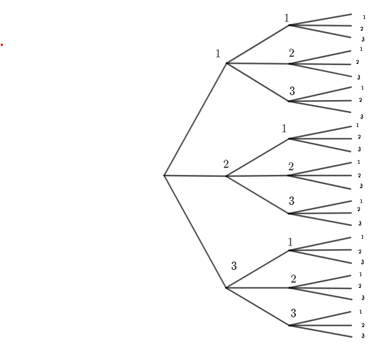
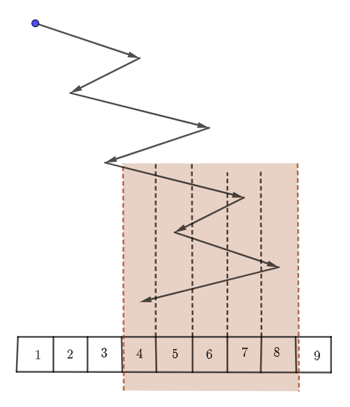
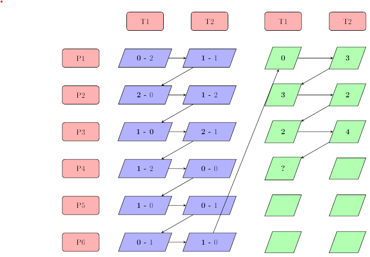

# Appendix — Supplement to the Documentation, Errata and Figures

Online appendix to the book **_An Applied Study of the Constraint Satisfaction Problem_** (Raimundo Santos Leite). It accompanies the source code of Algorithm **P1** (this folder) and Algorithm **P2** ([`../prouesse2`](../prouesse2)).

> **Important note:** The comments added to the code of *Prouesse1* and *Prouesse2* were generated by AI (AI may make mistakes).

**Contents:** [Part I](#part-i-supplement-to-the-documentation) · [Part II](#part-ii-errata) · [Part III](#part-iii-figures) · [Part IV](#part-iv-differences-between-the-book-and-the-code) · [Part V](#part-v-documentation-of-the-variables-of-prouesse1-and-prouesse2)

---

## PART I: SUPPLEMENT TO THE DOCUMENTATION

In `Module_1B`, cases 501, 510, 511, and 2 are very similar to Cases 1, 10, 11, and 2, respectively, of `Module_2A` of the *Prouesse2* project. The `Module_A_` class obtains important information for the ordering of the Teachers, an ordering that is used exclusively by the processing of `Module_1B` (afterward, `Module_2A` obtains another appropriate ordering).

There is a simpler way to analyze the code of *Prouesse2*, in which the `Module_3B` class is not necessary, its functionality being executed by `Module_3A`, which is a simpler class. Thus the `Module_3B` class can be disregarded, and `Module_3A` makes up for the absence of that class. To run *Prouesse2* in this way, it is necessary to replace, in `Module_2B`, the call to the `case_50` method with a call to `case_5` (`case_50` uses two auxiliary classes, whereas `case_5` uses only `Module_3A`). However, tests have shown that, in general, the execution speed with `case_50` is faster than execution with `case_5`.

## PART II: ERRATA

If you find any error in the book, please report it by email to:

**rstosleite@gmail.com**

## PART III: FIGURES

**Figure 1** shows the search tree for determining integers $x_1, x_2, x_3 \in \{1,2,3\}$ such that $x_1+x_2+x_3 = 7$.



**Figure 2** illustrates the backtracking analysis during the execution of Algorithm 2 of Chapter 3. The rule for backtracking is implemented in the method `determineArray_0`, which builds a table with all the backtracking possibilities.



**Figure 3** shows how the schedule-generation algorithm would work if the week had two days, with 6 teachers and 2 classes.



## PART IV: DIFFERENCES BETWEEN THE BOOK AND THE CODE

To facilitate the use of the book in understanding the code of the *Prouesse1* and *Prouesse2* programs, we present some differences between the details explained in the book and the Java code of these programs:

1. The method `successor` in the book may or may not be, in each class, subdivided into several methods in the code. The identifier `successor` is not used in the code: identifiers starting with `maximum` are used instead.
2. In the book, the method `successor` simply determines the variable `x0`, whereas, in the code, each method `maximum*` returns `false` when it is successful, and `true` when it does not determine `x0` (when it is successful, the value determined for `x0` is used by the program).
3. In the code, `minX0` and `maxX0` are variables that delimit the interval that `x0` must satisfy.
4. The variable `case` in the book appears as `case_` in the code.
5. In the book the variable `ns` is used, whereas, in the code, the functionality of this variable is fulfilled by the set of variables formed by `nClassesP`, `list`, and `ns`. Thus, `nClassesP[p]` is the number of classes of Teacher *p*, `list[p][j]` is the number of the *j*-th class of Teacher *p* and `ns[p][j]` is the weekly teaching load of Teacher *p* in their *j*-th class (note the different indexing for `ns`, compared with the indexing used in the book).

The method used to solve a scheduling problem consists of dividing it into subproblems. Each subproblem is solved by a different module, to which a Java class is linked and which applies the algorithms explained in Chapter 3 of the book in the solution process. To find out which Java class implements each module and the corresponding sections of the book, simply consult Section 1.1 of the book.

In the *Prouesse1* project, the difference between the classes `Module_2A.java` and `Module_2B.java` is that the latter implements the important feature of maximizing the number of possibilities for determining the working days of the Teachers (this maximization is explained in Section 4.7 of the book).

The documentation of the *Prouesse1* and *Prouesse2* versions is presented in the book, and here only a supplement is given. Our goal in what follows is to establish a bridge between the documentation in the book and the source code made available for the *Prouesse1* program (we do not do this for *Prouesse2* because we will focus on Chapter 4 of the book, which refers to *Prouesse1*).

In several executions of the successor determination, the goal is to update the variable `x0` to a value larger (than the initial `x0`) and that is contained in the interval `[minX0, maxX0]`. The methods of several classes that have this type of update are considered below and, for each of them, the determination of the bounds `minX0` and `maxX0` is presented and explained.

```text
Class Module_2A - Method maximum_2 (described in Section 4.3.5 of the book):

Below we present a block of statements from the maximum_2 method, followed by an indication of its effect on the
determination of x0:

minX0 = (noDoublePeriodsP[p] ? n0 - wp1[p] : n0 - 2 * wp1[p]);
minX0 = Math.max(minX0, Sp2 + n0 - Np1[p]);
minX0 = Math.max(minX0, Sa2 + n0 - 2 * Ma); // 2022
maxX0 = (noDoublePeriodsP[p] ? wp0[p] : 2 * wp0[p]);
maxX0 = Math.min(maxX0, n0);
maxX0 = Math.min(maxX0, Np0[p] - Sp0);
maxX0 = Math.min(maxX0, 2 * Ma - Sa0);

The variable n0 represents the total number of lessons of (p,a) that is split between two parts of the week.

Since minX0 <= x0 <= maxX0, the way minX0 and maxX0 are calculated has the following consequences:

noDoublePeriodsP[p]:  x0 <= wp0[p]
otherwise:    x0 <= 2*wp0[p]
x0 <= Np0[p] - Sp0 ===> Sp0 + x0 <= Np0[p]
x0 <= 2*Ma - Sa0 ===> Sa0 + x0 <= 2*Ma

minX0 <= x0 <= maxX0 ===> -maxX0 <= -x0 <= -minX0 ===> n0-maxX0 <= n0-x0 <= n0-minX0,
such that the way minX0 and maxX0 are calculated has the following consequences:

noDoublePeriodsP[p]:  n0 - x0 <= wp1[p]
otherwise:    n0 - x0 <= 2*wp1[p]
n0 - x0 <= -Sp2 + Np1[p] ===> Sp2 + n0 - x0 <= Np1[p]
n0 - x0 <= -Sa2 + 2*Ma ===> Sa2 + n0 - x0 <= 2*Ma

n0 - x0 >= 0
```

The goal of the method is to determine a new value for `x0`, larger than the old value, and the smallest one that satisfies the inequalities above. If no value exists under these conditions, the method returns `true` (in the book this is described as the method `successor` returning the `generator`).

Next, we do the same for other methods and classes:

```text
--------------------------------------------------------

Class Module_3 - Method maximum_4 (described in Section 4.4.1 of the book):

maxX0 = (noDoublePeriodsP[p] ? 1 : 2);
maxX0 = Math.min(maxX0, n0);
maxX0 = Math.min(maxX0, Np2[p] - Sp0);
maxX0 = Math.min(maxX0, Ma - Sa0);
minX0 = (noDoublePeriodsP[p] ? n0 - 1 : n0 - 2);
minX0 = Math.max(minX0, Sp2 + n0 - Np3[p]);
minX0 = Math.max(minX0, Sa2 + n0 - Ma);

noDoublePeriodsP[p]:  x0 <= 1
otherwise:    x0 <= 2
x0 <= Np2[p] - Sp0 ===> Sp0 + x0 <= Np2[p]
x0 <= Ma - Sa0 ===> Sa0 + x0 <= Ma

noDoublePeriodsP[p]:  n0 - x0 <= 1
otherwise:    n0 - x0 <= 2
n0 - x0 <= -Sp2 + Np3[p] ===> Sp2 + n0 - x0 <= Np3[p]
n0 - x0 <= -Sa2 + Ma ===> Sa2 + n0 - x0 <= Ma

n0 - x0 >= 0

--------------------------------------------------------

Class Module_4 - Method maximum - Case 2 (described in Section 4.5.3 of the book):

minX0 = ( noDoublePeriodsP[p] ? n0-aux0 : n0-2*aux0 );
minX0 = Math.max(minX0, Sp2 + n0 - Np1[p]);
minX0 = Math.max(minX0, Sa2 + n0 - Ma);
maxX0 = ( noDoublePeriodsP[p] ? wp0[p] : 2*wp0[p] );
maxX0 = Math.min(maxX0, n0);
maxX0 = Math.min(maxX0, Np0[p] - Sp0);
maxX0 = Math.min(maxX0, 2*Ma-Sa0);

noDoublePeriodsP[p]:  x0 <= wp0[p]
otherwise:    x0 <= 2*wp0[p]
x0 <= Np0[p] - Sp0 ===> Sp0 + x0 <= Np0[p]
x0 <= 2*Ma - Sa0 ===> Sa0 + x0 <= 2*Ma

The variable aux0, which can take the value 0 or 1, indicates whether Teacher p will work on the third day
for which Module_4 is executed.

noDoublePeriodsP[p]:  n0 - x0 <= aux0
otherwise:    n0 - x0 <= 2*aux0
n0 - x0 <= -Sp2 + Np1[p] ===> Sp2 + n0 - x0 <= Np1[p]
n0 - x0 <= -Sa2 + Ma ===> Sa2 + n0 - x0 <= Ma

n0 - x0 >= 0

--------------------------------------------------------

Class Module_4 - Method maximum - Case 4 (described in Section 4.5.4 of the book):

The analysis of this case is identical to the analysis of the method maximum_4 (Class Module_3) seen above.
```

## PART V: DOCUMENTATION OF THE VARIABLES OF PROUESSE1 AND PROUESSE2

First consider the *Prouesse2* project. We will present the project's variables: the classes where the variables are used, where they are declared, and where the array variables are initialized, with the correct sizing (see the tables below for more complete information).

The control variables and the location variables of the control variables, `Sp0_[ ]`, `Sp1_[ ]`, `Sa_0[ ]`, `Sa_1[ ]`, `pointerP2[ ]` and `pointerA[ ]`, have identical identifiers when they are declared in the classes `Module_3B`, `Accessory_classes` and `Probl` (these variables are inherited by the subclasses of these last two classes; these subclasses are: `Module_3A` and `Module_2B`, respectively), but this is not a problem, because, being declared in different classes, they are not shared by classes that run simultaneously. The risk of sharing is that the class `Module_2B` runs simultaneously with the classes `Module_3B` and `Module_3A`.

Next we present the remaining control variables and location variables of the control variables of the classes `Module_3B` and `Module_3A`: `Sp2_[ ]`, `Sp3_[ ]`, `Sa_4[ ]`, `Sa_5[ ]`, `pointerP[ ]` and `pointerA2[ ]` (all of these are declared in `Probl`, but they are not necessary for `Module_2B`, therefore, they are not shared by classes that run simultaneously).

Next, we will see where the control variables and the location variables of the control variables are initialized:

- **`Module_2B`:** In the constructor of the class `PhaseB2_E`, which is called in the constructor of `PhaseA1_Super`, which, in turn, is called in the constructor of `Module_2A`.
- **`Module_3B`:** Those that are declared in the class itself are initialized in its constructor. Those that are declared in `Probl` are initialized in the constructor of the class `PhaseB2_E`.
- **`Module_3A`:** Those that are inherited from `Accessory_classes` are initialized in its constructor (the constructor is executed when an object of type `Module_4`, which inherits from `Accessory_classes`, is created). Those that are declared in `Probl` are initialized in the constructor of the class `PhaseB2_E`.

The main moments of initialization of array-type variables are when an object of the class `Module_2A` and an object of `Module_4` are created.

The group 1 variables are: `Ap[ ]`, `Aa[ ]`, `j_[ ]`, `case_[ ]`, `A[ ]`, `x_[ ]`, `i`, `n2`, `x0`, `iMaxI_[ ]`, `z[ ][ ]`, `y2[ ][ ]`. Not even the variables `i` and `n2` can be shared by classes that run simultaneously. Next, where the group 1 variables are declared and initialized for each of the classes:

- **`Module_2A`:** Declared in `Probl` and initialized in the constructor of the class `PhaseB2_E`, just as was seen for certain control variables and location variables of the control variables.
- **`Module_2B`:** The same as what was said for the class `Module_2A`.
- **`Module_3B`:** Declared in the class itself and initialized by array assignments from the class `Accessory_classes`.
- **`Module_3A`:** Declared and initialized in `Accessory_classes`.

Next, we organize this information into a table of variables.

### Table of Prouesse2 variables

| Class where variables are used | Variable group | Declaration location | Variables | Initialization location | Required dimension |
|---|---|---|---|---|---|
| `Module_2A` | 1 | `Probl` | `p_ a_ j_ case_ A x_ i n2 x0 iMaxI_ z` | `PhaseB2_E` | aux+2Qp+7 |
| | 2 | `Probl` | `Sp0_ Sp1_ Sa_0 Sa_1 pointerP2 pointerA` | `PhaseB2_E` | |
| `Module_2B` | 1 | `Probl` | `p_ a_ j_ case_ A x_ i n2 x0 iMaxI_ z y2` | `PhaseB2_E` | aux+2Qp+7 |
| | 2 | `Probl` | `Sp0_ Sp1_ Sa_0 Sa_1 pointerP2 pointerA` | `PhaseB2_E` | |
| `Module_3A` | 1 | `Accessory_classes` | `p_ a_ j_ case_ A x_ i n2 x0 iMaxI_ z y2` | `Accessory_classes` | 2aux+2Qp+7 |
| | 2 | `Accessory_classes` | `Sp0_ Sp1_ Sa_0 Sa_1 pointerP2 pointerA` | `Accessory_classes` | |
| | | `Probl` | `Sp2_ Sp3_ Sa_4 Sa_5 pointerP pointerA2` | `PhaseB2_E` | |
| `Module_3B` | 1 | `Module_3B` | `p_ a_ j_ case_ A x_ i n2 x0 iMaxI_ z y2` | `Accessory_classes` | 2aux+2Qp+7 |
| | 2 | `Module_3B` | `Sp0_ Sp1_ Sa_0 Sa_1 pointerP2 pointerA` | `Accessory_classes` | |
| | | `Probl` | `Sp2_ Sp3_ Sa_4 Sa_5 pointerP pointerA2` | `PhaseB2_E` | |
| `Module_4` | 1 | `Accessory_classes` | `p_ a_ j_ case_ A x_ i n2 x0 iMaxI_ z y2` | `Accessory_classes` | 2aux+2Qp+7 |
| | 2 | `Accessory_classes` | `Sp0_ Sp1_ Sa_0 Sa_1 pointerP2 pointerA` | `Accessory_classes` | |
| | | `Probl` | `Sp2_ Sp3_ Sa_4 Sa_5 pointerP pointerA2` | `PhaseB2_E` | |
| `Module_5` | 1 | `Probl` | `p_ a_ j_ case_ A x_ i n2 x0 iMaxI_ z` | `PhaseB2_E` | aux |

- The group 2 variables are control variables and location variables of the control variables.
- The parameter `aux` in the table above is calculated as the sum of the numbers of classes of all the Teachers.

Next we present the corresponding table for the *Prouesse1* project.

### Table of Prouesse1 variables

| Class where variables are used | Variable group | Declaration location | Variables | Initialization location | Required dimension |
|---|---|---|---|---|---|
| `Module_1` | 1 | `Probl` | `Ap Aa j_ A case_ x_` | `PhaseA1_Super` | |
| | 2 | `Module_1` | `Sp2_ Sp3_ pointerP` | `Module_1` | aux+4Qp+7 |
| `Module_2B` | 1 | `PhaseB2_Super` | `Ap Aa j_ case_ A x_ i n2 x0 iMaxI_ z` | `PhaseB2_E` | |
| | 2 | `PhaseB2_Super` | `Sp0_ Sp1_ Sa_0 Sa_1 pointerP2 pointerA` | `PhaseB2_E` | aux+7Qp+12 |
| `Module_3` | 1 | `Module_3` | `Ap Aa j_ x_ i n2 iMaxI_ z` | `PhaseA1_Super` | |
| | 2 | `PhaseB2_Super` | `Sp2_ Sp3_ Sa_4 Sa_5 pointerP pointerA2` | `PhaseB2_E` | aux+5 |
| `Module_4` | 1 | `PhaseB2_Super` | `Ap Aa j_ case_ A x_ i n2 x0 iMaxI_ z` | `PhaseB2_E` | |
| | 2 | `PhaseB2_Super` | `Sp0_ Sp1_ Sa_0 Sa_1 pointerP2 pointerA` | `PhaseB2_E` | |
| | | `PhaseB2_Super` | `Sp2_ Sp3_ Sa_4 Sa_5 pointerP pointerA2` | `PhaseB2_E` | 2aux+2Qp+7 |
| `Module_5` | 1 | `Probl` | `Ap Aa j_ case_ A x_ i n2 x0 iMaxI_ z` | `PhaseA1_Super` | aux |

- Some array variables are sized with max{ 2aux+2Qp+7, aux+7Qp+12 }, because they are shared by two distinct classes.
