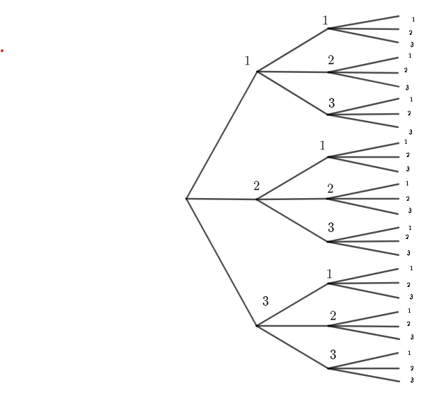
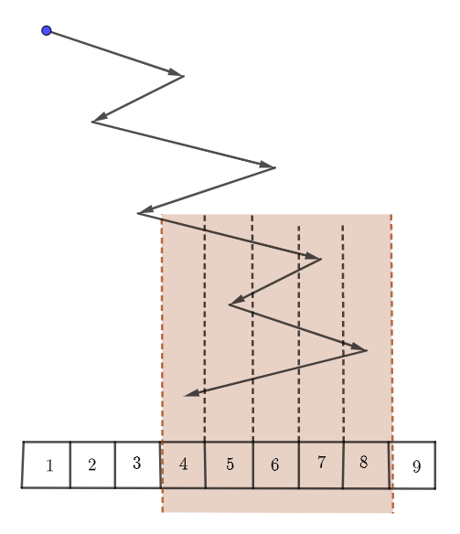
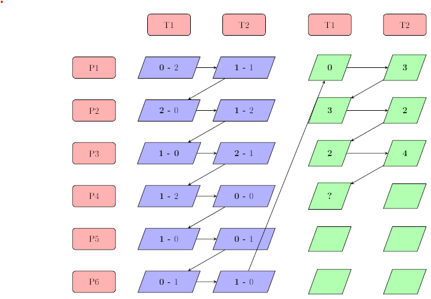

# Errata e Complemento da Documentação

Material complementar ao livro em português sobre o Prouesse. Acompanha o código-fonte dos Algoritmos **P1** (esta pasta) e **P2** ([`../prouesse2`](../prouesse2)).

> **Obs. importante:** Os comentários adicionados ao código de *Prouesse1* e *Prouesse2* foram gerados por I.A. (I.A. pode cometer erros).

**Conteúdo:** [Parte I](#parte-i-errata) · [Parte II](#parte-ii-figuras) · [Parte III](#parte-iii-complemento-da-documentação) · [Parte IV](#parte-iv-documentação-das-variáveis-de-prouesse1-e-prouesse2)

---

## PARTE I: ERRATA

1. Na Seção 5.2.2, no parágrafo que termina com "... permitem que a demanda por aulas de cada uma das Qa turmas, em cada parte da semana, seja atendida" é mencionada a "última validação executada no Caso 11"; no entanto, houve uma alteração na ordem de execução, de forma que a validação mencionada passa a ser executada anteriormente às execuções do método `detPossib_`.
2. Conforme previsto, os programas foram adaptados para 4, 5 ou 6 aulas por turma, por dia da semana, e disponibilizados neste repositório (GitHub), tanto *Prouesse1* como *Prouesse2*. O código disponibilizado também já está atualizado para essas quantidades de aulas. As alterações executadas nos programas não invalidam as informações apresentadas na Seção 4.8 do livro, as quais estão de acordo com a nova versão.
3. As informações contidas no livro (Seção 4.7.1), explicando resumidamente o Módulo 1, referem-se à classe `Module_1` do projeto *Prouesse1*. Porém, essa classe passou por grandes melhorias, de forma que as informações mencionadas na Seção 4.7.1 podem ser consideradas obsoletas. Com as melhorias mencionadas, foi obtida a classe `Module_1B`, disponibilizada juntamente com as outras classes do projeto *Prouesse1*. Em `Module_1B`, os casos 501, 510, 511 e 2 são muito semelhantes aos Casos 1, 10, 11 e 2, respectivamente, de `Module_2A` do projeto *Prouesse2*. Foi criada também a classe `Module_A_`, que obtém informações importantes para a ordenação dos Profs., uma ordenação que é utilizada exclusivamente pelos processamentos de `Module_1B` (depois o `Module_2A` obtém outra ordenação apropriada).
4. A variável que é identificada no livro com "gerador" está com o identificador `minimo` no código disponibilizado.
5. Existe uma forma mais simples de análise do código de *Prouesse2*, em que a classe `Module_3B` não é necessária, tendo sua funcionalidade executada por `Module_3A`, que é uma classe mais simples. Assim a classe `Module_3B` pode ser desconsiderada, e `Module_3A` supre a falta daquela classe. Para a execução de *Prouesse2* dessa forma, é preciso substituir, em `Module_2B`, a chamada do método `case_50` pela chamada de `case_5` (`case_50` utiliza duas classes acessórias, ao passo que `case_5` utiliza apenas `Module_3A`). Porém, os testes mostraram que, em geral, a velocidade de execução com `case_50` é maior que a execução com `case_5`.

Caso encontre algum erro no livro, peço informar por email para:

**rstosleite@gmail.com**

## PARTE II: FIGURAS

A **Figura 1** mostra a árvore de busca para a determinação de inteiros $x_1, x_2, x_3 \in \{1,2,3\}$ tais que $x_1+x_2+x_3 = 7$.



A **Figura 2** ilustra a análise de recuo durante a execução do Algoritmo 2 do Capítulo 3. A regra para recuo é implementada no método `determinaArranjo_0`, o qual monta uma tabela com todas as possibilidades de recuo.



A **Figura 3** mostra como seria o funcionamento do algoritmo de obtenção de horários se a semana tivesse dois dias, com 6 professores e 2 turmas.



## PARTE III: COMPLEMENTO DA DOCUMENTAÇÃO

Para facilitar o uso do livro na compreensão do código dos programas *Prouesse1* e *Prouesse2*, apresentamos algumas diferenças entre os detalhes explicados no livro e o código em Java desses programas:

1. A variável `gerador` do livro é `minimo` no código.
2. O método `sucessor` do livro pode estar ou não estar, em cada classe, subdividido em vários métodos no código. No código não é usado o identificador `sucessor`: são usados identificadores começando com `maximo`.
3. No livro, o método `sucessor` simplesmente determina a variável `x0`, ao passo que, no código, cada método `maximo*` retorna `false` quando é bem-sucedido, e `true` quando não determina `x0` (quando é bem-sucedido, o valor determinado em `x0` é utilizado pelo programa).
4. No código, `minX0` e `maxX0` são variáveis que delimitam o intervalo que `x0` deve respeitar.
5. A variável `case` do livro está como `case_` no código.
6. No livro, menciona-se que o código iria ser adaptado para valores da variável `Ma` diferentes de 5; essa adaptação já foi feita, para os seguintes valores de `Ma`: 4, 5 ou 6.
7. No livro é utilizada a variável `ns`, ao passo que, no código, a funcionalidade dessa variável é cumprida pelo conjunto de variáveis formado por `nTurmasP`, `lista` e `ns`; assim, `nTurmasP[p]` é a quantidade de turmas do Prof. *p*, `lista[p][j]` é o número da *j*-ésima turma do Prof. *p* e `ns[p][j]` é a carga horária semanal do Prof. *p* na sua *j*-ésima turma (observe a indexação diferente para `ns`, comparada com a indexação utilizada no livro).

O método usado para resolver um problema de horários consiste em dividi-lo em subproblemas. Cada subproblema é resolvido por um módulo diferente, ao qual está vinculada uma classe Java e que aplica os algoritmos explicados no Capítulo 3 do livro no processo de solução. Para saber a classe Java que implementa cada módulo e as correspondentes seções do livro, é só consultar a Seção 1.1 do livro.

No projeto *Prouesse1*, a diferença entre as classes `Module_2A.java` e `Module_2B.java` é que a segunda destas implementa o importante recurso de maximização das quantidades de possibilidades de determinação dos dias de trabalho dos Profs. (essa maximização é explicada na Seção 4.7 do livro).

A documentação das versões *Prouesse1* e *Prouesse2* é apresentada no livro, e aqui é dado apenas um complemento. Nosso objetivo a seguir é estabelecer uma ponte entre a documentação no livro e o código-fonte disponibilizado para o programa *Prouesse1* (não fazemos isso para *Prouesse2* porque focaremos no Capítulo 4 do livro, que se refere a *Prouesse1*).

Em várias execuções da determinação do sucessor, o objetivo é atualizar a variável `x0` por um valor maior (que o `x0` inicial) e que esteja contido no intervalo `[minX0, maxX0]`. Os métodos de várias classes que têm esse tipo de atualização são considerados a seguir e, para cada um deles, é apresentada e explicada a determinação dos limitantes `minX0` e `maxX0`.

```text
Classe Module_2A - Método maximo_2 (descrito na Seção 4.3.5 do livro):

A seguir apresentamos um bloco de comandos do método maximo_2, seguido da indicação do seu efeito na
determinação de x0:

minX0 = (semGeminadasP[p] ? n0 - wp1[p] : n0 - 2 * wp1[p]);
minX0 = Math.max(minX0, Sp2 + n0 - Np1[p]);
minX0 = Math.max(minX0, Sa2 + n0 - 2 * Ma); // 2022
maxX0 = (semGeminadasP[p] ? wp0[p] : 2 * wp0[p]);
maxX0 = Math.min(maxX0, n0);
maxX0 = Math.min(maxX0, Np0[p] - Sp0);
maxX0 = Math.min(maxX0, 2 * Ma - Sa0);

A variável n0 representa a quantidade total de aulas de (p,a) que é repartida entre duas partes da semana.

Como minX0 <= x0 <= maxX0, a forma como são calculados minX0 e maxX0 tem as seguintes consequências:

semGeminadasP[p]:  x0 <= wp0[p]
caso contrário:    x0 <= 2*wp0[p]
x0 <= Np0[p] - Sp0 ===> Sp0 + x0 <= Np0[p]
x0 <= 2*Ma - Sa0 ===> Sa0 + x0 <= 2*Ma

minX0 <= x0 <= maxX0 ===> -maxX0 <= -x0 <= -minX0 ===> n0-maxX0 <= n0-x0 <= n0-minX0,
de maneira que a forma como são calculados minX0 e maxX0 tem as seguintes consequências:

semGeminadasP[p]:  n0 - x0 <= wp1[p]
caso contrário:    n0 - x0 <= 2*wp1[p]
n0 - x0 <= -Sp2 + Np1[p] ===> Sp2 + n0 - x0 <= Np1[p]
n0 - x0 <= -Sa2 + 2*Ma ===> Sa2 + n0 - x0 <= 2*Ma

n0 - x0 >= 0
```

O objetivo do método é determinar um novo valor para `x0`, maior que o valor antigo, e o menor que cumpra as desigualdades acima. Se não existir nenhum valor nessas condições, o método retorna `true` (no livro isso é descrito com o método `sucessor` retornando o `gerador`).

A seguir, fazemos o mesmo para outros métodos e classes:

```text
--------------------------------------------------------

Classe Module_3 - Método maximo_4 (descrito na Seção 4.4.1 do livro):

maxX0 = (semGeminadasP[p] ? 1 : 2);
maxX0 = Math.min(maxX0, n0);
maxX0 = Math.min(maxX0, Np2[p] - Sp0);
maxX0 = Math.min(maxX0, Ma - Sa0);
minX0 = (semGeminadasP[p] ? n0 - 1 : n0 - 2);
minX0 = Math.max(minX0, Sp2 + n0 - Np3[p]);
minX0 = Math.max(minX0, Sa2 + n0 - Ma);

semGeminadasP[p]:  x0 <= 1
caso contrário:    x0 <= 2
x0 <= Np2[p] - Sp0 ===> Sp0 + x0 <= Np2[p]
x0 <= Ma - Sa0 ===> Sa0 + x0 <= Ma

semGeminadasP[p]:  n0 - x0 <= 1
caso contrário:    n0 - x0 <= 2
n0 - x0 <= -Sp2 + Np3[p] ===> Sp2 + n0 - x0 <= Np3[p]
n0 - x0 <= -Sa2 + Ma ===> Sa2 + n0 - x0 <= Ma

n0 - x0 >= 0

--------------------------------------------------------

Classe Module_4 - Método máximo - Caso 2 (descrito na Seção 4.5.3 do livro):

minX0 = ( semGeminadasP[p] ? n0-aux0 : n0-2*aux0 );
minX0 = Math.max(minX0, Sp2 + n0 - Np1[p]);
minX0 = Math.max(minX0, Sa2 + n0 - Ma);
maxX0 = ( semGeminadasP[p] ? wp0[p] : 2*wp0[p] );
maxX0 = Math.min(maxX0, n0);
maxX0 = Math.min(maxX0, Np0[p] - Sp0);
maxX0 = Math.min(maxX0, 2*Ma-Sa0);

semGeminadasP[p]:  x0 <= wp0[p]
caso contrário:    x0 <= 2*wp0[p]
x0 <= Np0[p] - Sp0 ===> Sp0 + x0 <= Np0[p]
x0 <= 2*Ma - Sa0 ===> Sa0 + x0 <= 2*Ma

A variável aux0, podendo assumir 0 ou 1, indica se Prof. p irá trabalhar no terceiro dia
para o qual Module_4 é executada.

semGeminadasP[p]:  n0 - x0 <= aux0
caso contrário:    n0 - x0 <= 2*aux0
n0 - x0 <= -Sp2 + Np1[p] ===> Sp2 + n0 - x0 <= Np1[p]
n0 - x0 <= -Sa2 + Ma ===> Sa2 + n0 - x0 <= Ma

n0 - x0 >= 0

--------------------------------------------------------

Classe Module_4 - Método máximo - Caso 4 (descrito na Seção 4.5.4 do livro):

A análise deste caso é idêntica à análise do método máximo_4 (Classe Module_3) vista acima.
```

## PARTE IV: DOCUMENTAÇÃO DAS VARIÁVEIS DE PROUESSE1 E PROUESSE2

Considere primeiramente o projeto *Prouesse2*. Vamos apresentar as variáveis do projeto: as classes onde as variáveis são usadas, onde são declaradas e onde são inicializadas as variáveis-arranjo, com o dimensionamento correto (veja as tabelas adiante para informações mais completas).

As variáveis de controle e de localização das variáveis de controle, `Sp0_[ ]`, `Sp1_[ ]`, `Sa_0[ ]`, `Sa_1[ ]`, `apontP2[ ]` e `apontA[ ]`, têm identificadores idênticos quando são declaradas nas classes `Module_3B`, `Classes_acessorias` e `Probl` (essas variáveis são herdadas pelas subclasses das duas últimas classes; estas subclasses são: `Module_3A` e `Module_2B`, respectivamente), mas isso não é problema, porque, sendo declaradas em classes diferentes, não são compartilhadas por classes que são executadas simultaneamente. O risco do compartilhamento é que a classe `Module_2B` é executada simultaneamente com as classes `Module_3B` e `Module_3A`.

A seguir apresentamos as demais variáveis de controle e de localização das variáveis de controle das classes `Module_3B` e `Module_3A`: `Sp2_[ ]`, `Sp3_[ ]`, `Sa_4[ ]`, `Sa_5[ ]`, `apontP[ ]` e `apontA2[ ]` (todas estas são declaradas em `Probl`, mas não são necessárias para `Module_2B`, por isso não são compartilhadas por classes que são executadas simultaneamente).

A seguir, veremos onde as variáveis de controle e de localização das variáveis de controle são inicializadas:

- **`Module_2B`:** No construtor da classe `FaseB2_E`, que é chamado no construtor de `FaseA1_Super`, que, por sua vez, é chamado no construtor de `Module_2A`.
- **`Module_3B`:** As que são declaradas na própria classe são inicializadas no seu construtor. As que são declaradas em `Probl` são inicializadas no construtor da classe `FaseB2_E`.
- **`Module_3A`:** As que são herdadas de `Classes_acessorias` são inicializadas no construtor desta (o construtor é executado quando é criado um objeto do tipo `Module_4`, o qual herda de `Classes_acessorias`). As que são declaradas em `Probl` são inicializadas no construtor da classe `FaseB2_E`.

Os principais momentos de inicialização de variáveis do tipo arranjo são quando são criados um objeto da classe `Module_2A` e um objeto de `Module_4`.

As variáveis do grupo 1 são: `Ap[ ]`, `Aa[ ]`, `j_[ ]`, `case_[ ]`, `A[ ]`, `x_[ ]`, `i`, `n2`, `x0`, `iMaxI_[ ]`, `z[ ][ ]`, `y2[ ][ ]`. Nem mesmo as variáveis `i` e `n2` podem ser compartilhadas por classes que executam simultaneamente. A seguir, onde são declaradas e inicializadas as variáveis do grupo 1 para cada uma das classes:

- **`Module_2A`:** Declaradas em `Probl` e inicializadas no construtor da classe `FaseB2_E`, assim como foi visto para certas variáveis de controle e de localização das variáveis de controle.
- **`Module_2B`:** O mesmo que foi dito para a classe `Module_2A`.
- **`Module_3B`:** Declaradas na própria classe e inicializadas por atribuições de arranjos da classe `Classes_acessorias`.
- **`Module_3A`:** Declaradas e inicializadas em `Classes_acessorias`.

A seguir, organizamos estas informações numa tabela de variáveis.

### Tabela das variáveis de Prouesse2

| Classe onde as variáveis são usadas | Grupo de variáveis | Local de declaração | Variáveis | Local de inicialização | Dimensão necessária |
|---|---|---|---|---|---|
| `Module_2A` | 1 | `Probl` | `p_ a_ j_ case_ A x_ i n2 x0 iMaxI_ z` | `FaseB2_E` | aux+2Qp+7 |
| | 2 | `Probl` | `Sp0_ Sp1_ Sa_0 Sa_1 apontP2 apontA` | `FaseB2_E` | |
| `Module_2B` | 1 | `Probl` | `p_ a_ j_ case_ A x_ i n2 x0 iMaxI_ z y2` | `FaseB2_E` | aux+2Qp+7 |
| | 2 | `Probl` | `Sp0_ Sp1_ Sa_0 Sa_1 apontP2 apontA` | `FaseB2_E` | |
| `Module_3A` | 1 | `Classes_acessorias` | `p_ a_ j_ case_ A x_ i n2 x0 iMaxI_ z y2` | `Classes_acessorias` | 2aux+2Qp+7 |
| | 2 | `Classes_acessorias` | `Sp0_ Sp1_ Sa_0 Sa_1 apontP2 apontA` | `Classes_acessorias` | |
| | | `Probl` | `Sp2_ Sp3_ Sa_4 Sa_5 apontP apontA2` | `FaseB2_E` | |
| `Module_3B` | 1 | `Module_3B` | `p_ a_ j_ case_ A x_ i n2 x0 iMaxI_ z y2` | `Classes_acessorias` | 2aux+2Qp+7 |
| | 2 | `Module_3B` | `Sp0_ Sp1_ Sa_0 Sa_1 apontP2 apontA` | `Classes_acessorias` | |
| | | `Probl` | `Sp2_ Sp3_ Sa_4 Sa_5 apontP apontA2` | `FaseB2_E` | |
| `Module_4` | 1 | `Classes_acessorias` | `p_ a_ j_ case_ A x_ i n2 x0 iMaxI_ z y2` | `Classes_acessorias` | 2aux+2Qp+7 |
| | 2 | `Classes_acessorias` | `Sp0_ Sp1_ Sa_0 Sa_1 apontP2 apontA` | `Classes_acessorias` | |
| | | `Probl` | `Sp2_ Sp3_ Sa_4 Sa_5 apontP apontA2` | `FaseB2_E` | |
| `Module_5` | 1 | `Probl` | `p_ a_ j_ case_ A x_ i n2 x0 iMaxI_ z` | `FaseB2_E` | aux |

- As variáveis do grupo 2 são variáveis de controle e de localização das variáveis de controle.
- O parâmetro `aux` na tabela acima é calculado como a soma das quantidades de turmas de todos os Profs.

A seguir apresentamos a tabela correspondente para o projeto *Prouesse1*.

### Tabela das variáveis de Prouesse1

| Classe onde as variáveis são usadas | Grupo de variáveis | Local de declaração | Variáveis | Local de inicialização | Dimensão necessária |
|---|---|---|---|---|---|
| `Module_1` | 1 | `Probl` | `Ap Aa j_ A case_ x_` | `FaseA1_Super` | |
| | 2 | `Module_1` | `Sp2_ Sp3_ apontP` | `Module_1` | aux+4Qp+7 |
| `Module_2B` | 1 | `FaseB2_Super` | `Ap Aa j_ case_ A x_ i n2 x0 iMaxI_ z` | `FaseB2_E` | |
| | 2 | `FaseB2_Super` | `Sp0_ Sp1_ Sa_0 Sa_1 apontP2 apontA` | `FaseB2_E` | aux+7Qp+12 |
| `Module_3` | 1 | `Module_3` | `Ap Aa j_ x_ i n2 iMaxI_ z` | `FaseA1_Super` | |
| | 2 | `FaseB2_Super` | `Sp2_ Sp3_ Sa_4 Sa_5 apontP apontA2` | `FaseB2_E` | aux+5 |
| `Module_4` | 1 | `FaseB2_Super` | `Ap Aa j_ case_ A x_ i n2 x0 iMaxI_ z` | `FaseB2_E` | |
| | 2 | `FaseB2_Super` | `Sp0_ Sp1_ Sa_0 Sa_1 apontP2 apontA` | `FaseB2_E` | |
| | | `FaseB2_Super` | `Sp2_ Sp3_ Sa_4 Sa_5 apontP apontA2` | `FaseB2_E` | 2aux+2Qp+7 |
| `Module_5` | 1 | `Probl` | `Ap Aa j_ case_ A x_ i n2 x0 iMaxI_ z` | `FaseA1_Super` | aux |

- Algumas variáveis-arranjo são dimensionadas com max{ 2aux+2Qp+7, aux+7Qp+12 }, porque são compartilhadas por duas classes distintas.
